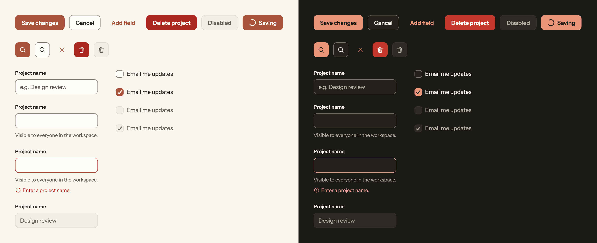

# Timbre

[](https://github.com/PaoloNavarretta/timbre-ui/actions/workflows/ci.yml)

A warm, accessible React component library: rigorous code underneath, creative freedom on top.

In sound, timbre is what makes the same note sound different on a piano and on a violin. Timbre components work the same way: the same behaviour and accessibility, a different character through the theme.



> **Status:** version 0.1.0: Button, TextField, icons, IconButton and Checkbox. Browse every component, with live examples and docs, in [Storybook](https://paolonavarretta.github.io/timbre-ui/).

## Highlights

- **Accessible by design.** Built and tested to meet WCAG 2.2 AA in both themes. Every story is checked with axe on every test run, and every component is tried by hand with the keyboard and VoiceOver. How it is tested, and the known limits, are on the [Accessibility page](https://paolonavarretta.github.io/timbre-ui/?path=/docs/guides-accessibility--docs).
- **Themes without JavaScript.** Light and dark come from one set of semantic tokens written with CSS `light-dark()`. Themes follow the system preference, or a `data-theme` attribute on any element, nested as deep as you like.
- **Easy to override.** All styles live in CSS cascade layers, so any style in your app wins without `!important` or long selectors.
- **Native first.** A `Button` is a `<button>`, a field has a real `<label>`. Native props and `ref` are forwarded, `className` is merged.
- **Small surface.** No runtime styling library, no global reset, no font files: one stylesheet and plain React components.

## Installation

```bash
pnpm add timbre-ui
```

Timbre needs React 19. It uses modern CSS (`light-dark()`, `:has()`, cascade layers), supported in Chrome and Edge 123, Firefox 121 and Safari 17.5 or later.

## Quick start

Import the stylesheet once, at the entry point of your app:

```ts
import "timbre-ui/styles.css";
```

Then use the components:

```tsx
import { Button } from "timbre-ui";

export function SaveBar() {
  return <Button variant="primary">Save changes</Button>;
}
```

### Font

Timbre is designed with [Instrument Sans](https://fontsource.org/fonts/instrument-sans) but does not ship font files. Load it in your app, for example with Fontsource:

```bash
pnpm add @fontsource-variable/instrument-sans
```

```ts
import "@fontsource-variable/instrument-sans";
```

Without it, Timbre falls back to the system sans-serif.

## Theming

Without a `data-theme` attribute, Timbre follows the user's system preference. To choose a theme, set the attribute on `<html>` or on any container:

```html
<html data-theme="timbre-light">
  <aside data-theme="timbre-dark">Always dark, inside a light page.</aside>
</html>
```

To apply your brand, redefine the public semantic tokens on a container:

```css
.my-brand {
  --timbre-color-primary: light-dark(#366b5e, #8fc7b6);
  --timbre-color-primary-hover: light-dark(#2b574c, #a8d6c8);
}
```

Tokens prefixed with `--_timbre-` are private and can change in any release.

## Components

| Component    | Status  |
| ------------ | ------- |
| `Button`     | Ready   |
| `TextField`  | Ready   |
| Icons        | Ready   |
| `IconButton` | Ready   |
| `Checkbox`   | Ready   |
| `Dialog`     | Planned |

## How it is built

| Area          | Choice                                                                                                                   |
| ------------- | ------------------------------------------------------------------------------------------------------------------------ |
| Language      | TypeScript in strict mode                                                                                                |
| Build         | Vite in library mode: ES modules, two entry points (`timbre-ui`, `timbre-ui/icons`), type declarations, one `styles.css` |
| Styles        | CSS Modules and custom properties inside the `timbre.*` cascade layers                                                   |
| Tests         | Storybook stories as tests: Vitest runs every story in Chromium, with interaction tests and axe                          |
| Docs          | Storybook, with MDX pages for foundations and guides                                                                     |
| Quality gates | Prettier, ESLint (with JSX accessibility rules), type checks, tests and both builds in CI                                |

Every tool, what it does and where it is configured: [docs/stack.md](./docs/stack.md). The reasoning behind the main choices is recorded in [docs/decisions](./docs/decisions/README.md).

## Development

You need Node 26 and pnpm (enabled through Corepack).

| Command          | What it does                                   |
| ---------------- | ---------------------------------------------- |
| `pnpm install`   | Installs the dependencies                      |
| `pnpm storybook` | Components and docs at `http://localhost:6006` |
| `pnpm test`      | Every story as a test, in Chromium             |
| `pnpm build`     | The library in `dist/`                         |

See [CONTRIBUTING.md](./CONTRIBUTING.md) for the workflow and the definition of done.

## Roadmap

1. **v0.1:** Button, TextField, icons, IconButton and Checkbox, light and dark themes, Storybook online, npm package.
2. **Next:** Dialog, built on a headless library chosen with a prototype; then Popover, Tooltip, Menu, Tabs and Select.
3. **Later:** a separate package of web components built on native elements.

## License

[MIT](./LICENSE)
